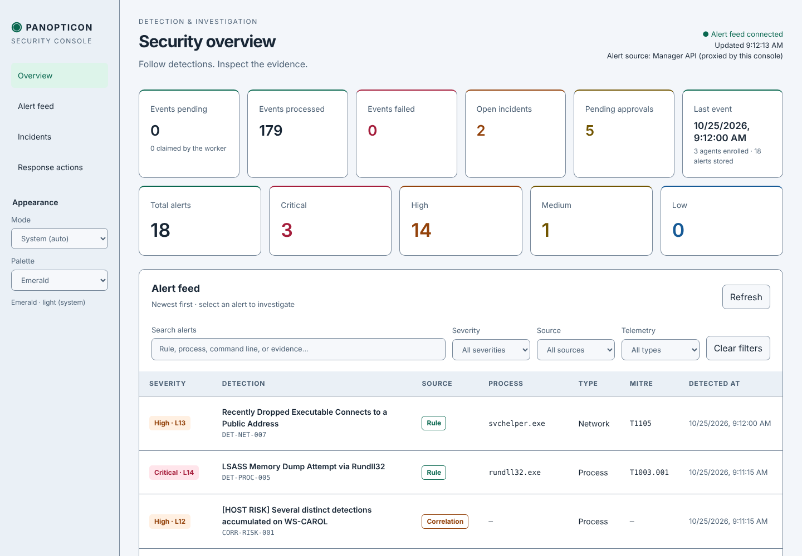
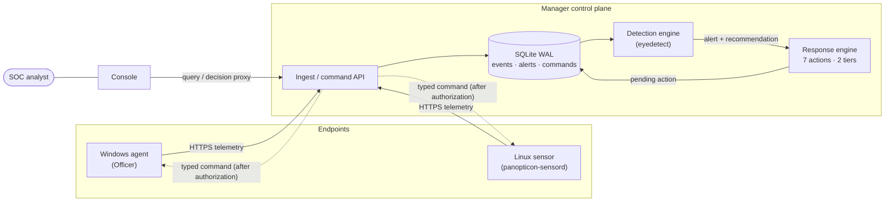
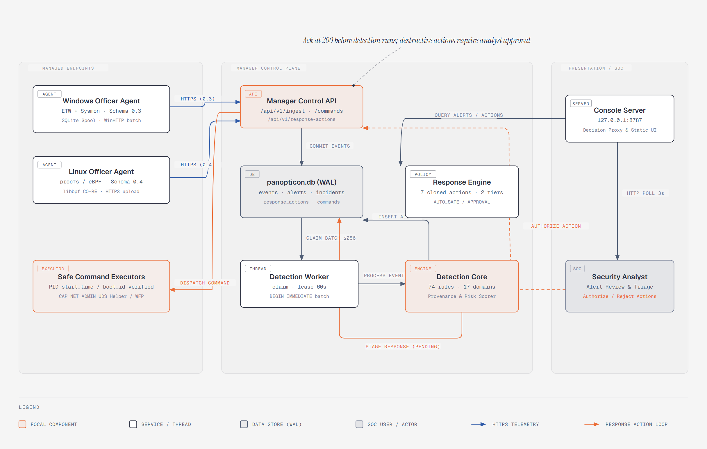
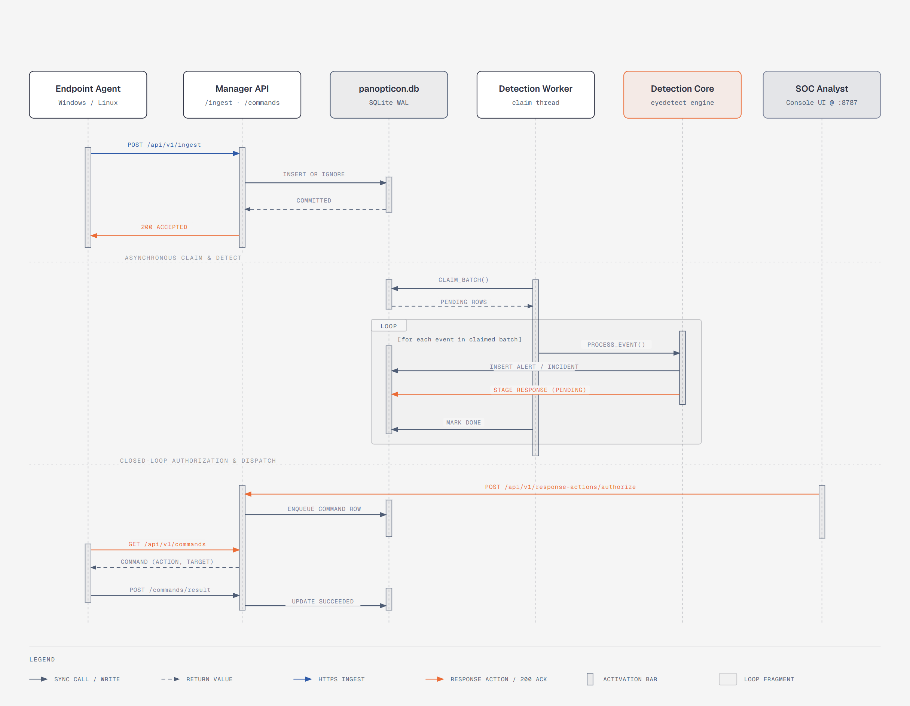
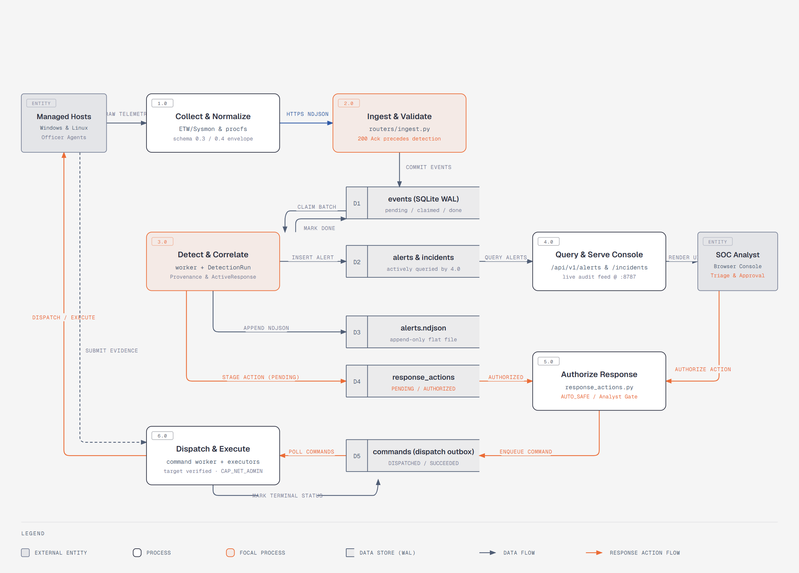
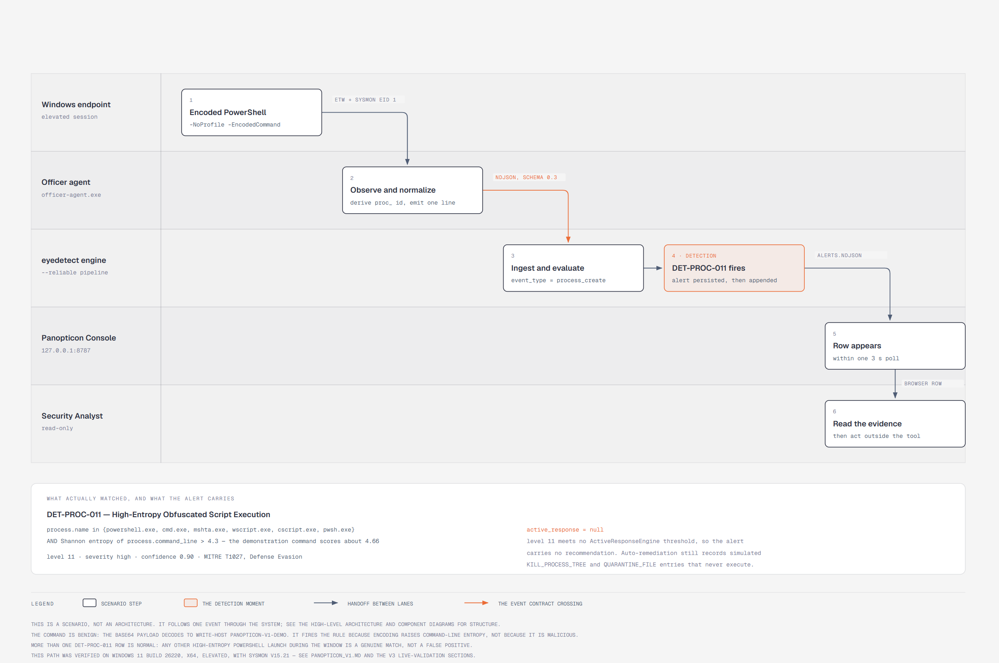
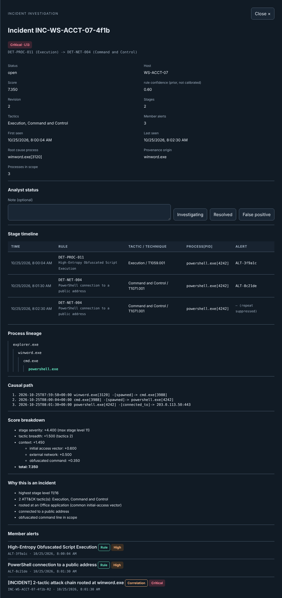
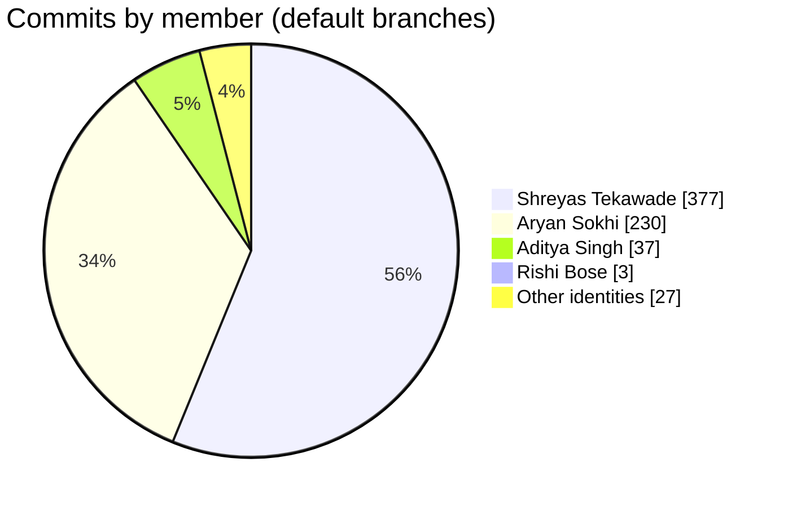

# Panopticon

**Endpoint telemetry, detection, and controlled response — end to end.**

Panopticon is a security-focused, multi-repository EDR/XDR capstone and research
platform. Endpoint agents on Windows and Linux collect real host telemetry, a
rule-, correlation- and behavior-based detection engine turns it into alerts and
incidents, and — only where an analyst or a narrow auto-safe policy allows it —
the Manager authorizes and dispatches one of a closed set of typed response
actions back to the originating endpoint, with full lifecycle tracking and audit.

This is a capstone/research project, not a commercial product. Maturity varies by
repository, and every repository's README states its own validated scope and
known limitations rather than hiding them.

**Project site: [panopticon-co.github.io](https://panopticon-co.github.io)** — architecture,
components, all 22 diagrams and team statistics in one place.

  
   
  <i>Panopticon Console in Manager mode — pipeline counters, alert severities and the live alert feed (lab data).</i>

## At a glance

| | |
|---|---|
| **Repositories** | 8 public components + organization profile (plus 2 private dashboard prototypes) |
| **Endpoints** | Windows agent "Officer" (C++20) · Linux sensor `panopticon-sensord` (C++20, eBPF) |
| **Backend** | FastAPI Manager with SQLite (WAL) stores, vendored detection and response engines |
| **Detection** | 69 MITRE ATT&CK–mapped detection rules in 16 categories, provenance-graph correlation, UEBA rarity scoring, an experimental ML scoring stage |
| **Response** | Closed vocabulary of 7 typed actions, two authorization tiers, signed commands and evidence |
| **Contributors** | 4 team members · 674 commits on default branches (see [Team and contributions](#team-and-contributions)) |

## Architecture

  
   
  <i>Figure 1 — Running components and trust boundaries: endpoints, the Manager control plane, and the console. Source: <a href="https://github.com/Panopticon-Co/panopticon-diagrams">panopticon-diagrams</a>.</i>

Detection and execution are deliberately separate. The detection engine and the
response engine only ever produce recommendations and typed commands — neither
calls `subprocess`, `os.kill` or any OS API. Only the endpoint agents execute
anything, and only after Manager authorization.

## Repositories

| Repository | Language | Role |
|---|---|---|
| [panopticon-agent](https://github.com/Panopticon-Co/panopticon-agent) | C++20 | Windows endpoint agent ("Officer"): ETW, Sysmon, Windows Event Log, USN journal, registry, file-integrity and PowerShell telemetry; durable encrypted delivery journal; Manager-authorized response execution |
| [panopticon-linux-agent](https://github.com/Panopticon-Co/panopticon-linux-agent) | C++20 / C | Linux sensor: eBPF CO-RE, fanotify, audit and netlink collection; on-disk WAL with at-least-once delivery; signed policy and commands; self-integrity monitoring |
| [panopticon-detection-engine](https://github.com/Panopticon-Co/panopticon-detection-engine) | Python | Rule evaluation, provenance-graph correlation, UEBA rarity scoring and alerting ("eyedetect"); detects and recommends, never executes |
| [panopticon-response-engine](https://github.com/Panopticon-Co/panopticon-response-engine) | Python | Pure domain library: the closed 7-action vocabulary, tier classification, recommendation translation, lifecycle state machine |
| [panopticon-manager](https://github.com/Panopticon-Co/panopticon-manager) | Python | FastAPI control plane: enrollment, ingestion, detection worker, response authorization/dispatch, signed evidence custody, audit |
| [panopticon-console](https://github.com/Panopticon-Co/panopticon-console) | Python / JS | Analyst console for alerts, incidents and response decisions (standard library only, no build step) |
| [panopticon-contracts](https://github.com/Panopticon-Co/panopticon-contracts) | JSON Schema | Canonical wire contracts and golden fixtures for telemetry, endpoint records and the command/result envelopes |
| [panopticon-diagrams](https://github.com/Panopticon-Co/panopticon-diagrams) | HTML / SVG | 22 architecture and UML diagrams, checked in CI against the source of the repositories they describe |

## How an event becomes an action

  
   
  <i>Figure 2 — Ingest is acknowledged once committed; detection runs asynchronously; a destructive action waits for analyst authorization before the endpoint polls for it.</i>

<table>
  <tr>
    <td width="50%" align="center">
       
      <i>Figure 3 — Level-1 data flow across the Manager's stores.</i>
    </td>
    <td width="50%" align="center">
       
      <i>Figure 4 — One obfuscated PowerShell launch, followed end to end.</i>
    </td>
  </tr>
</table>

  
   
  <i>Incident investigation in the console: stage timeline, process lineage, causal path and an explained score (lab data).</i>

## Security-oriented design

- **A closed response vocabulary.** `KILL_PROCESS`, `COLLECT_PROCESS_INFO`,
  `COLLECT_NETWORK_CONNECTIONS`, `COLLECT_FILE`, `QUARANTINE_FILE`, `ISOLATE_HOST`,
  `RELEASE_HOST_ISOLATION` — there is no path to arbitrary remote execution.
- **Two authorization tiers.** Only `COLLECT_PROCESS_INFO` and
  `COLLECT_NETWORK_CONNECTIONS` may run automatically; every other action,
  including file collection, requires explicit analyst approval.
- **PID-reuse protection.** Process-targeted actions carry the process start time
  (and, on Windows, the boot binding) so an action can never land on a recycled PID.
- **Signed commands and evidence.** The Linux sensor executes only Manager-signed
  (ES256) commands; evidence is signed with endpoint-enrolled keys and verified on
  every retrieval; and a SHA-256 hash-chained audit trail records who requested,
  approved, dispatched and viewed what.
- **Versioned wire contracts.** Every producer and consumer is checked against the
  golden fixtures in `panopticon-contracts`.

## Team and contributions

<table>
  <tr>
    <td align="center"><a href="https://github.com/shreyastek"> <b>Shreyas Tekawade</b></a></td>
    <td align="center"><a href="https://github.com/sokhiaryan"> <b>Aryan Sokhi</b></a></td>
    <td align="center"><a href="https://github.com/Adityasingh230058"> <b>Aditya Singh</b></a></td>
    <td align="center"><a href="https://github.com/RishiBose08"> <b>Rishi Bose</b></a></td>
  </tr>
</table>

| Member | Commits | Lines added | Lines deleted | Of which source code added |
|---|---:|---:|---:|---:|
| Shreyas Tekawade | 377 | 126,372 | 6,449 | 96,598 |
| Aryan Sokhi³ | 230 | 106,332 | 27,915 | 55,926 |
| Aditya Singh | 37 | 29,709 | 5,596 | 26,726 |
| Rishi Bose³ | 3 | 625 | 322 | 482 |
| Other identities¹ | 27 | 7,763 | 374 | 5,829 |
| **Total** | **674** | **270,801** | **40,656** | **185,561** |

**Commits per repository**

| Repository | Shreyas | Aryan³ | Aditya | Rishi³ | Other¹ | Total |
|---|---:|---:|---:|---:|---:|---:|
| panopticon-linux-agent | 209 | 7 | – | – | – | 216 |
| panopticon-manager² | 56 | 60 | – | – | 12 | 128 |
| panopticon-detection-engine | 38 | 52 | 27 | – | 8 | 125 |
| panopticon-agent | 32 | 48 | – | – | – | 80 |
| panopticon-contracts | 11 | 30 | – | – | – | 41 |
| panopticon-response-engine | 11 | 19 | – | – | 3 | 33 |
| panopticon-console | 9 | 13 | – | 2 | 4 | 28 |
| panopticon-diagrams | 9 | 1 | 2 | 1 | – | 13 |
| private dashboard prototypes (2) | – | – | – | 8 | – | 8 |
| .github | 2 | – | – | – | – | 2 |

How these numbers were measured

Snapshot taken 2026-11-07 from each repository's default branch.

- Non-merge commits only, attributed by author email (one person with two
  addresses is counted once).
- A commit present in more than one repository is counted once.
  ² The Manager was seeded from the detection engine's history; the 48 shared
  commits are counted under `panopticon-detection-engine`.
- Lines are `git log --numstat` additions and deletions. Excluded: vendored and
  third-party code, lock files, binaries and images, captured evidence/log files,
  ML result dumps and training manifests, and the generated 131k-line
  `vmlinux.h` BTF header. One private repository that mirrors another's
  frontend contributes commits but no lines, to avoid counting the same files twice.
- "Source code" means C/C++, Python, JavaScript, shell/PowerShell, CMake, SQL,
  HTML/CSS and YAML (detection rules); the remainder is documentation, schemas
  and test fixtures.
- ¹ "Other identities" are commits made under shared or automation identities
  rather than a personal account.
- ³ Commits made under Rishi Bose's Git identity on or after 2026-10-01 are
  credited to Aryan Sokhi, to whom the team attributes that work; earlier
  commits stay with Rishi Bose. Git history itself is unchanged.

Lines changed measure churn, not effort or quality: a refactor that deletes
code is as valuable as one that adds it.

## Platform support

- **Windows** — endpoint agent with documented x64 and ARM64 builds.
- **Linux** — sensor validated on Ubuntu 22.04, kernel 5.15, x86_64.
- **Backend and console** — platform-independent Python.

macOS and mobile endpoints are not supported and are not currently planned.

## Development status

The project follows a vertical-slice-first roadmap: telemetry → detection → alert
was built and validated first, then response authorization and execution, then
broader telemetry and response depth. For the precise, evidence-backed status of
each component, start with:

- Windows agent — [capability matrix](https://github.com/Panopticon-Co/panopticon-agent/blob/main/docs/windows-endpoint/CAPABILITY_MATRIX.md)
- Linux agent — [handoff and validation status](https://github.com/Panopticon-Co/panopticon-linux-agent/blob/main/docs/HANDOFF.md)
- Manager — [response engine state](https://github.com/Panopticon-Co/panopticon-manager/blob/main/docs/RESPONSE_ENGINE_STATE.md)
- Contracts — [cross-repository compatibility matrix](https://github.com/Panopticon-Co/panopticon-contracts/blob/master/docs/COMPATIBILITY.md)

## Contributing

Each repository has its own `CONTRIBUTING.md` for its toolchain (CMake/vcpkg for
the C++ agents, pytest for the Python services). Keep changes focused, add or
update tests, and call out any cross-repository contract impact in the pull request.

## Reporting a security issue

Please **do not open a public issue** for a suspected vulnerability. Each
repository's `SECURITY.md` explains how to report privately through GitHub
Security Advisories. This is a capstone/research project maintained on a
best-effort basis, with no formal response SLA.

## License

All Panopticon-Co repositories are licensed under the [MIT License](https://github.com/Panopticon-Co/panopticon-manager/blob/main/LICENSE) unless a repository's own `LICENSE` file states otherwise.

## Disclaimer

Panopticon is a capstone and research project. It is not a certified, audited or
commercially supported security product, and no claims of production-readiness,
compliance or formal security certification are made.
